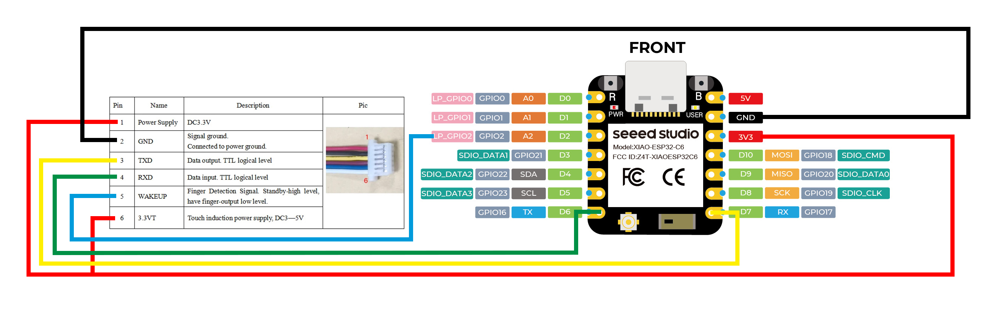

This is a step-by-step guide for a Fingerprint all-in-one project working with Thread. It is inspired by [this video from Domotica per Tutti](https://www.youtube.com/watch?v=EEh26tGFiz4)

**<ins>[REQUIRED MATERIALS]</ins>**

1.- ESP32-C6

2.- R503 Fingerprint reader

**<ins>[WIRING DIAGRAM]</ins>**

The ESP32-C6 must be flashed with [this YAML](fingerprint-thread.yaml) in ESPHome. The program is prepared for the ESP32 to connect to a Thread network.

**<ins>[HOW TO USE THE FINGERPRINT]</ins>**

In Home Assistant go to: Developer tools >>> Actions

To add fingerprints: esphome.tagreader_fingerprint_thread_enroll

To cancel adding fingerprints process: esphome.tagreader_fingerprint_thread_cancel_enroll

To delete a single fingerprint: esphome.tagreader_fingerprint_thread_delete

To delete all fingerprints: esphome.tagreader_fingerprint_thread_delete_all
